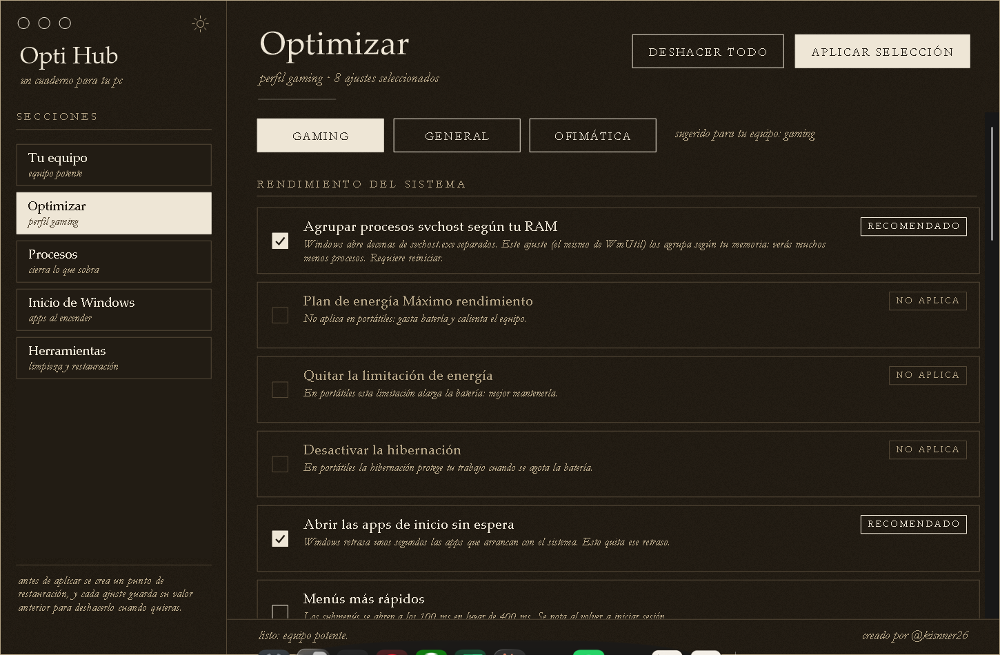

# Opti Hub

Creado por **[@kisnner26](https://github.com/kisnner26)**.

Optimiza Windows 11 según tu hardware, con perfiles **Gaming**, **General** y **Ofimática**. Misma estética de cuaderno que [Cursor Hub](https://github.com/kisnner26/cursor-hub).

## Descarga

**[OptiHub.exe](https://github.com/kisnner26/opti-hub/releases/latest/download/OptiHub.exe)**: un solo archivo portable. Pide permisos de administrador al abrirse. SmartScreen puede avisar porque no está firmado: *Más información → Ejecutar de todos modos*.

Ficha técnica completa: **[Opti-Hub-guia.pdf](docs/Opti-Hub-guia.pdf)**.

## Qué hace

- **Tu equipo**: reconoce CPU, RAM, gráfica (dedicada o integrada), disco (HDD, SSD o NVMe), si es portátil o sobremesa y la versión de Windows, y sugiere un perfil.
- **Optimizar**: 25 ajustes agrupados por sección. Cada perfil marca los recomendados según tu hardware; los que no convienen a tu equipo (por ejemplo, el plan Máximo rendimiento en un portátil) aparecen como *no aplica*.
- **Procesos**: los que más memoria usan, con opción de cerrarlos. Los procesos del sistema (svchost, lsass, dwm…) están protegidos.
- **Inicio de Windows**: activa o desactiva las apps que arrancan con el equipo, igual que el Administrador de tareas.
- **Herramientas**: punto de restauración, limpieza de temporales, Liberador de espacio, reinicio del Explorador y acceso a la [WinUtil de Chris Titus](https://github.com/ChrisTitusTech/winutil).

## Seguridad

- Antes de aplicar se crea un **punto de restauración**.
- Cada ajuste guarda su **valor anterior** en `%LOCALAPPDATA%\OptiHub\backup` y se puede deshacer uno a uno o todos a la vez.
- **No** desactiva Defender, UAC, Windows Update, SmartScreen ni las protecciones de la CPU.
- svchost no se cierra: se agrupa según tu RAM (`SvcHostSplitThresholdInKB`, el mismo ajuste que usa WinUtil).

Necesita permisos de administrador para cambiar servicios y ajustes del sistema.

## Compilar

Ejecuta `build.bat`. Usa el compilador de C# que ya trae Windows (.NET Framework 4.x).

## Créditos

- Autor: **[@kisnner26](https://github.com/kisnner26)** (diseño, icono y código).
- Varios ajustes están inspirados en [WinUtil](https://github.com/ChrisTitusTech/winutil) de Chris Titus Tech.
- Estética basada en [creador-de-flores](https://github.com/kisnner26/creador-de-flores).
